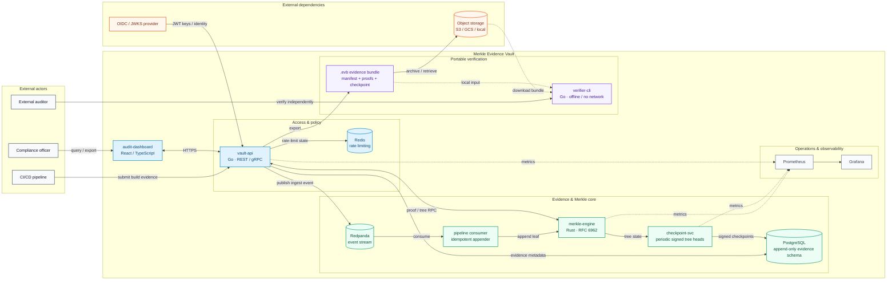

# Architecture — Merkle Evidence Vault

## System overview

The diagram below is the primary GitHub-rendered view of the runtime and verification boundaries. It complements the detailed C4 views that follow.



### Architectural intent

- **Append-only evidence path:** ingestion flows through `vault-api`, the event stream, the idempotent consumer, and `merkle-engine`; evidence metadata is retained in PostgreSQL.
- **Cryptographic checkpointing:** `checkpoint-svc` periodically signs tree state so proofs can be bound to a signed checkpoint.
- **Portable verification:** exported `.evb` bundles are designed to be checked by `verifier-cli` without network access or trust in the running service.
- **Separated trust boundaries:** identity comes from the configured OIDC/JWKS provider, object storage is an external availability layer, and offline verification remains out-of-band.
- **Operational visibility:** Prometheus and Grafana observe the runtime but are not part of the proof trust root.

## C4 Level 1 — System Context
```
┌─────────────────────────────────────────────────────────────────────┐
│  External Actors                                                    │
│                                                                     │
│  [CI/CD Pipeline]  [Compliance Officer]  [External Auditor]        │
│         │                  │                      │                 │
│         └──────────────────┴──────────────────────┘                │
│                            │ HTTPS / JWT                            │
│                            ▼                                        │
│              ┌─────────────────────────┐                           │
│              │  MERKLE EVIDENCE VAULT  │                           │
│              │    (this system)        │                           │
│              └─────────────────────────┘                           │
│                            │                                        │
│              ┌─────────────┴──────────┐                            │
│          [OIDC Provider]    [Object Storage]                        │
│          (external)         (S3/GCS/local)                         │
└─────────────────────────────────────────────────────────────────────┘
```

## C4 Level 2 — Container Diagram
```
┌──────────────────────────────────────────────────────────────────────────┐
│  MERKLE EVIDENCE VAULT                                                   │
│                                                                          │
│  ┌─────────────────┐    REST/gRPC      ┌──────────────────────────┐     │
│  │  audit-dashboard│ ◄────HTTPS──────► │       vault-api          │     │
│  │  (React/TS)     │                   │  (Go, chi + tonic)       │     │
│  │  :5173 dev      │                   │  :8443 HTTPS :9443 gRPC  │     │
│  └─────────────────┘                   └────────────┬─────────────┘     │
│                                                     │                    │
│                          ┌──────────────────────────┼──────────────┐    │
│                          │                          │              │    │
│                     Unix/mTLS gRPC            TCP+TLS         Kafka│    │
│                          │                          │              │    │
│                          ▼                          ▼              ▼    │
│              ┌───────────────────┐   ┌──────────────────┐  ┌──────────┐│
│              │  merkle-engine    │   │    postgres:5432  │  │redpanda  ││
│              │  (Rust, RFC 6962) │   │  append-only      │  │:9092     ││
│              │  :9444 gRPC       │   │  Merkle schema    │  │          ││
│              └────────┬──────────┘   └──────────────────┘  └──────────┘│
│                       │                                          │       │
│              ┌────────▼──────────┐              ┌───────────────▼─────┐ │
│              │  checkpoint-svc   │              │  pipeline consumer  │ │
│              │  (Go, periodic    │              │  (Go, idempotent    │ │
│              │   STH signing)    │              │   Merkle appender)  │ │
│              └───────────────────┘              └─────────────────────┘ │
│                                                                          │
│              ┌──────────────────────────────────────────────────────┐   │
│              │  verifier-cli (Go, offline, no network, ships as     │   │
│              │  standalone binary — used by auditors out-of-band)   │   │
│              └──────────────────────────────────────────────────────┘   │
│                                                                          │
│  Supporting: Redis:6379 (rate-limit), Prometheus:9090, Grafana:3000     │
└──────────────────────────────────────────────────────────────────────────┘
```

## C4 Level 3 — vault-api Component Diagram
```
vault-api
│
├── cmd/server/main.go          Entry point, dependency wiring
│
├── config/                     YAML + env-var config loading
│
├── middleware/
│   ├── auth.go                 JWKS cache → JWT validation → role extraction
│   ├── ratelimit.go            Redis sliding window, fail-open
│   ├── logging.go              Structured zerolog per-request
│   └── audit.go                Append-only audit log write on every request
│
├── handler/
│   ├── ingest.go               Validate → dedup → persist → enqueue
│   ├── query.go                Evidence lookup, proof delegation, checkpoints
│   ├── audit.go                Paginated audit trail read
│   ├── export.go               Bundle creation + download
│   └── health.go               Liveness + readiness probes
│
├── internal/
│   ├── merklerpc/client.go     gRPC client → merkle-engine (implements merkle.Engine)
│   └── pipeline/
│       ├── publisher.go        Redpanda ingest event writer
│       └── consumer.go         Idempotent Merkle append consumer
│
└── domain/
    ├── evidence/types.go       Evidence value object, LeafData() binding
    ├── merkle/interface.go     Engine interface (testable, mockable)
    ├── checkpoint/types.go     STH types + policy
    └── bundle/format.go        .evb manifest + archive layout constants
```
